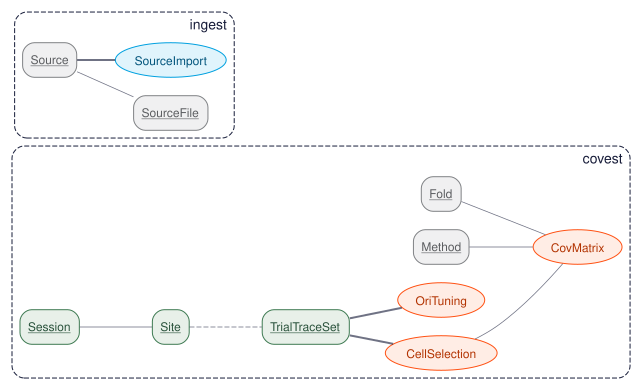

# neurocorr

Improved estimation and interpretation of correlations in neural circuits, as a DataJoint
pipeline in Python.

This repository reproduces the analysis of:

> Dimitri Yatsenko, Krešimir Josić, Alexander S. Ecker, Emmanouil Froudarakis, R. James Cotton,
> and Andreas S. Tolias (2015). **Improved estimation and interpretation of correlations in neural
> circuits.** *PLOS Computational Biology* 11(3): e1004083.
> [doi:10.1371/journal.pcbi.1004083](https://doi.org/10.1371/journal.pcbi.1004083)

It is a translation of the study's original code and data,
[atlab/cov-est](https://github.com/atlab/cov-est) (MIT License, © 2014 Tolias Lab), from DataJoint
for MATLAB to DataJoint 2 for Python. The schema follows the original `covest` schema table for
table, and the estimators are ported from its `+cove` package to numpy and scipy.

## Attribution

- **The study** is by the authors above. The article is published under the
  [Creative Commons Attribution 4.0 License](https://creativecommons.org/licenses/by/4.0/).
- **The data** are the two-photon recordings published with the original code in
  [atlab/cov-est/data](https://github.com/atlab/cov-est/tree/master/data). They are not copied into
  this repository: the pipeline downloads them from a pinned commit and verifies their SHA-256.
- **The original code**, [atlab/cov-est](https://github.com/atlab/cov-est), is © 2014 Tolias Lab
  under the MIT License. This repository is a derivative work under the same license; see
  [LICENSE](LICENSE).
- **To cite** this work, cite the article. [CITATION.cff](CITATION.cff) lists the article and the
  original code.

## The pipeline



| Table | Tier | One row is | Original |
|---|---|---|---|
| `SourceFile` | Lookup | a data file published with the original code, with its SHA-256 | (new) |
| `SourceImport` | Ingest | the import of one file's recordings into `Traces` | (new) |
| `Traces` | Entry | the binned activity of one imaging site in every trial of one stimulus set | `covest.Traces` |
| `ActiveCells` | Compute | the cells of a correlation set that stay active throughout the recording | `covest.ActiveCells` |
| `Method` | Lookup | a covariance estimator and the grids of its hyperparameters | `covest.Method` |
| `Fold` | Lookup | a fold of 10-fold cross-validation, or all trials (`nfolds = 1`) | `covest.Fold` |
| `CovMatrix` | Compute | a correlation matrix estimated on a fold's training trials, its hyperparameters, and its validation loss on the fold's test trials | `covest.CovMatrix` |

`SourceImport` stands in for the upstream lab pipeline that filled the original `Traces`: it
downloads a file, verifies it, and inserts its recordings into `Traces`, which keeps the original
table unchanged. `Traces` has no foreign key to `SourceImport` (fan-out ingestion), so the diagram
draws them apart.

### The data

Each site is a population of 106–328 neurons in layers 2/3 of mouse primary visual cortex,
recorded with 3D random-access two-photon microscopy. Activity is inferred firing rate, binned in
150 ms bins aligned on stimulus onset. Each site has two stimulus sets (`high_repeats`):

- **Correlation sets** (31 sites): drifting gratings in 2 or 5 directions, about 100–300 trials of
  each, with 1 s of grating and 1 s of blank per trial. Noise correlations are estimated from these.
- **Tuning sets** (29 sites): 16 directions, 12–34 trials of each, for orientation tuning.

`trace_segments` is a bins × directions × trials × cells array, padded with NaN where a direction
has fewer trials than others.

### Storage

Every array (traces, cell positions, correlation matrices, means, variances, search traces) is a
`<npy@>` attribute: a standard `.npy` file in the default object store, at a path that mirrors the
schema, fetched lazily (`np.asarray` loads it). `datajoint.json` points the default store at
`data/store` in the repository; any file, S3, GCS, or Azure store works (`DJ_STORES` or the
`stores` section of `datajoint.json`).

### Estimators

| `method` | Estimator | Hyperparameters |
|---|---|---|
| 0 | sample correlation, all bins | none |
| 1 | sample correlation, evoked bins only | none |
| 2, 3 | sample correlation, evoked bins of one direction (two-direction sites) | none |
| 10 | shrinkage toward a diagonal target (C<sub>diag</sub>) | variance shrinkage toward the median variance; correlation shrinkage toward zero |

The factor-analysis, sparse (graphical lasso), and sparse + latent estimators of the paper are next.

### Cross-validation

Each method is estimated on the training trials of 10 folds and evaluated on the held-out trials
with the normal (Gaussian) loss, in nats per cell per bin. Hyperparameters are chosen by an inner
10-fold cross-validation on the training trials: a random search seeds a pattern search on the
logarithmic grids in `Method`. The fold `nfolds = 1` estimates from all trials, with hyperparameters
chosen the same way.

### Differences from the MATLAB code

- **Fold membership.** Trial slots are assigned to folds by a fixed numpy permutation instead of
  MATLAB's `rng(0); randperm`. The structure is the same: each trial slot belongs to one fold for
  every direction, and all methods see the same folds.
- **Variance regularization.** `find_best_delta` returns the value with the lowest loss on its grid.
  `findBestDelta.m` returns the value one step past it.
- **Random search.** Seeded from the key of each `CovMatrix` row, so results are reproducible.
- **Columns.** `Method.condition` is `condition_idx`, because `condition` is a reserved word in SQL.
  `Method.hyperparam_space` is JSON. `CovMatrix.test_matrix` (a copy of the test trials) is
  dropped, and so is `QuadLoss`, which is not in the paper.

## Quick start

```bash
# install
uv sync --group dev            # or: pip install -e .

# start a local PostgreSQL database
cd local && docker compose up -d && cd ..
mkdir -p .secrets && echo datajoint > .secrets/database.password
mkdir -p data/store            # the default object store in datajoint.json
```

```python
from neurocorr.pipeline import covest

covest.SourceImport.populate()       # downloads the four data files (218 MB); 60 rows of Traces
covest.ActiveCells.populate()        # 31 correlation sets; 27 keep more than 100 cells
covest.CovMatrix.populate()          # every method, site, and fold
```

The data files are cached in `~/.cache/neurocorr`, or in the directory named by
`NEUROCORR_DATA_DIR`. Schema names take the prefix in the `DATABASE_PREFIX` environment variable.

## Configuration

The bare `<npy@>` form needs datajoint-python after release 2.3.4, so the dependency points at its
`master` branch until the next release. For an S3-compatible store, install the `s3` extra
(`pip install -e ".[s3]"`).

`datajoint.json` holds the non-secret settings; credentials come from `.secrets/` or the `DJ_USER`
and `DJ_PASS` environment variables. To use MySQL instead of PostgreSQL, set `DJ_BACKEND=mysql`,
`DJ_HOST`, and `DJ_PORT`.

## Development

```bash
uv sync --group dev
pytest tests/unit          # fast, no database
pytest                     # all tests; starts PostgreSQL with testcontainers (requires Docker)
ruff check src tests && ruff format src tests
```

## Project structure

```
neurocorr/
├── src/neurocorr/
│   ├── pipeline/covest.py    # the schema
│   ├── cove/                 # estimators and cross-validation (port of +cove)
│   └── ingest/               # fetching, verifying, and reading the original data files
├── tests/unit, tests/integration
├── local/docker-compose.yml  # PostgreSQL for development
├── datajoint.json
├── CITATION.cff
└── LICENSE                   # MIT, as atlab/cov-est
```

## License

MIT, the license of the original code; see [LICENSE](LICENSE). The article is CC-BY 4.0.
